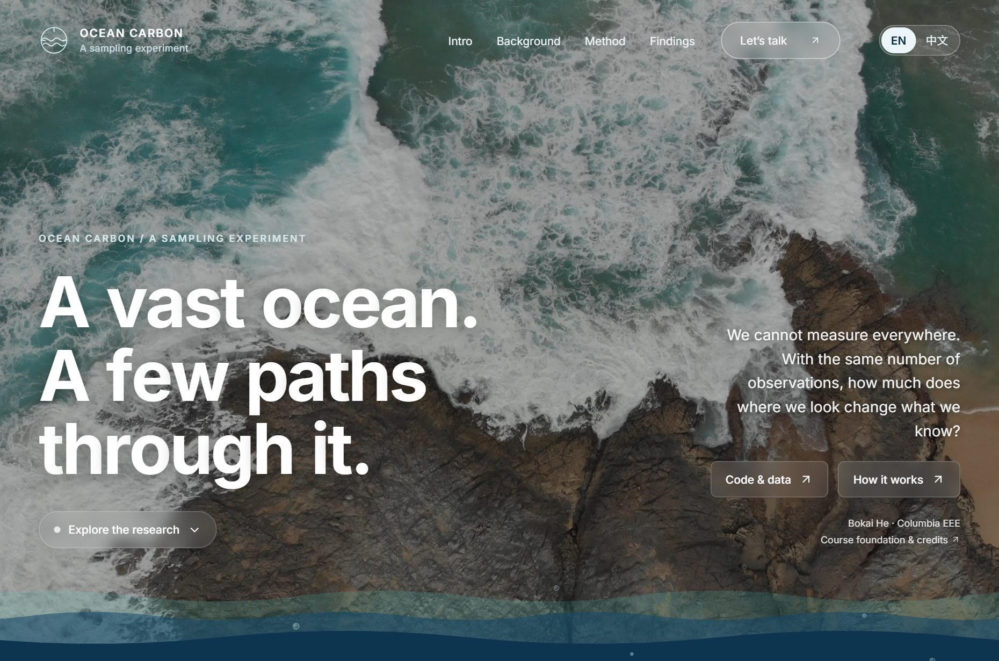
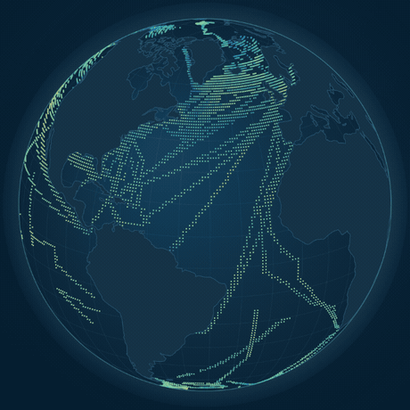
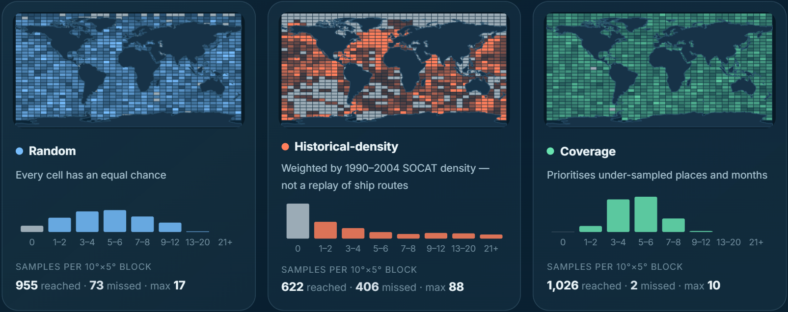
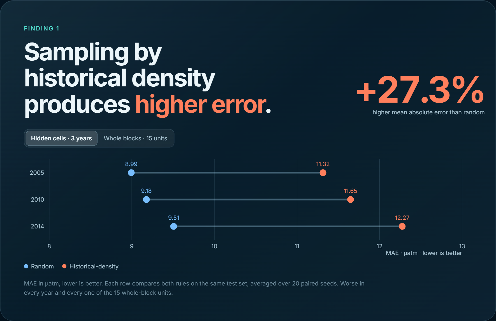
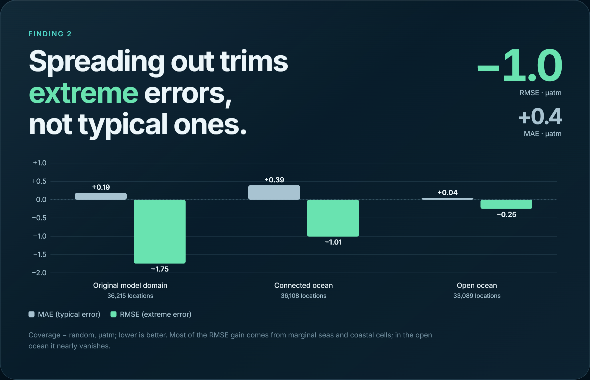
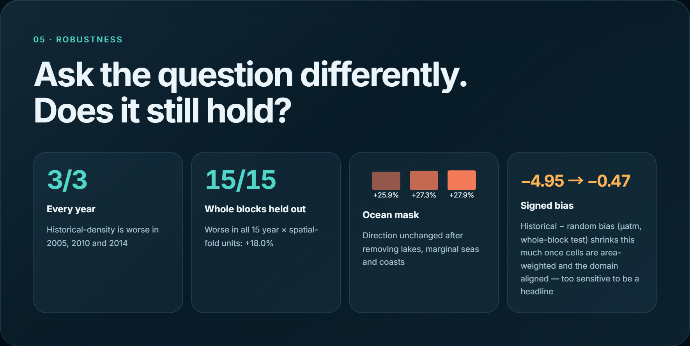
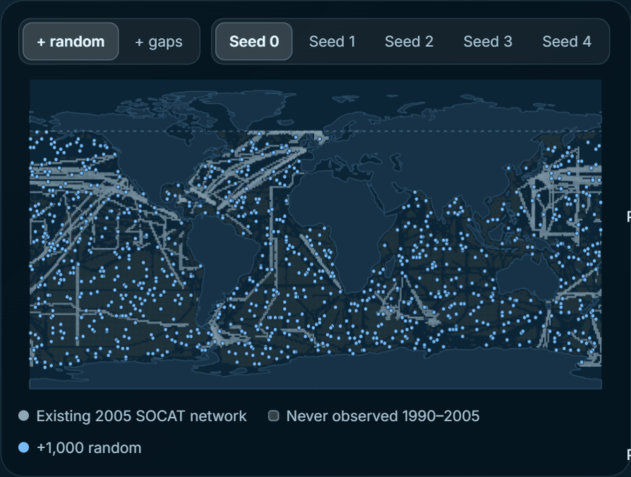
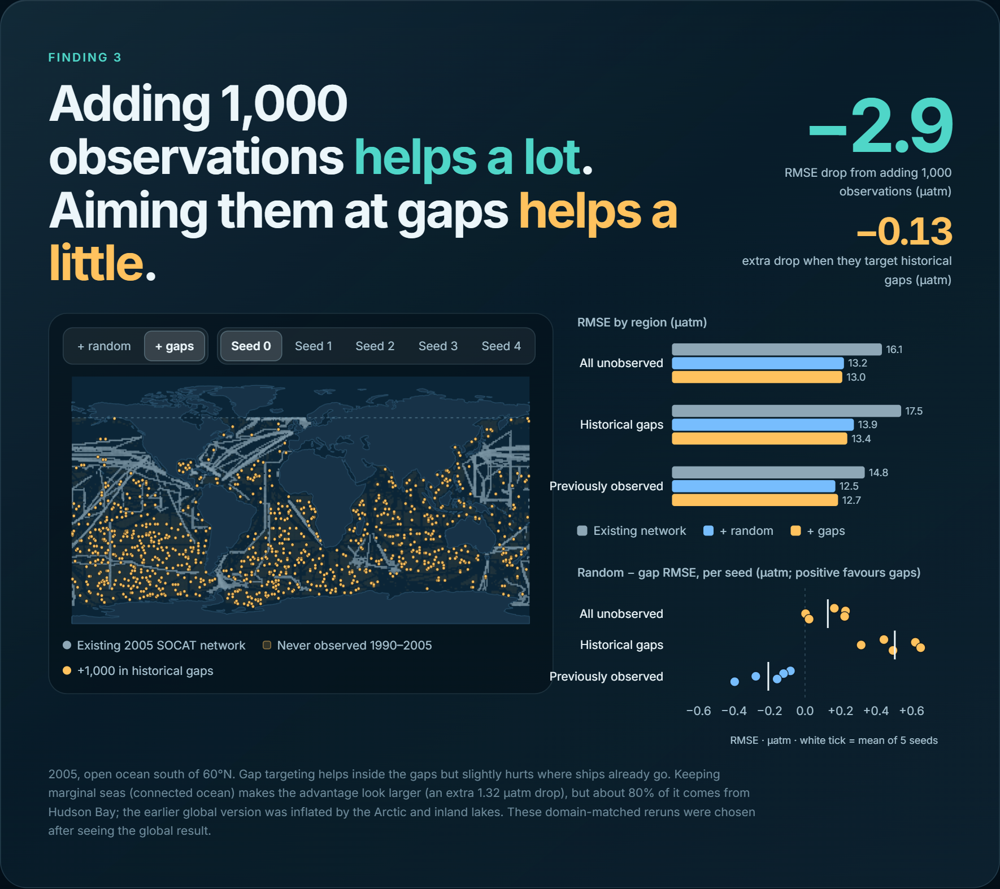

<div align="center">



# Ocean Carbon Sampling

**A vast ocean. A few paths through it.**<br>
Does *where* we measure ocean CO₂ change how well machine learning can map it?

[**Open the research brief →**](https://bokaihe.github.io/ocean-carbon-sampling/) &nbsp;·&nbsp; English / 中文 &nbsp;·&nbsp; [results notebook](notebooks/published/osse_results_walkthrough.ipynb)

<br>

| Historical-density vs random | Whole blocks held out | Even coverage vs random | Add 1,000 observations |
|:---:|:---:|:---:|:---:|
| **+27.3%** MAE<br>3/3 years worse | **+18.0%** MAE<br>15/15 units worse | RMSE **−1.0** µatm<br>MAE **+0.4** µatm | RMSE **−2.9** µatm<br>gaps only **−0.13** more |

<sub>One simulated ocean (IPSL-CM6A-LR) as truth · one locked HistGradientBoosting learner · 5,000 samples · area-weighted · candidates and evaluation south of 60°N in the connected ocean · 20 paired seeds. Augmentation: 2005, open-ocean interior, 5 seeds (domain chosen after the global run).</sub>

</div>

---

### Where ships have looked

<table>
<tr>
<td width="44%"></td>
<td>Real measurements are sparse and follow ship tracks. Each dot is a 1° grid cell with SOCAT v2025 surface-water fCO₂; in 2014 only <b>3.4%</b> of monthly 1° ocean cells had one.<br><br>
Real data have no complete answer key, so the experiment uses an Earth-system-model ocean as truth, hides part of it, and asks how well each sampling rule recovers it.</td>
</tr>
</table>

### Three rules, the same 5,000 samples


<sub>Illustrative maps: 2005, seed 0, before the ocean mask. Grey blocks received no samples.</sub>

### Sampling by historical density produces higher error


<table>
<tr>
<td width="50%"><b>Spreading out trims extreme errors, not typical ones</b><br></td>
<td width="50%"><b>Does it still hold?</b><br></td>
</tr>
</table>

### Adding to the real network



> **Where we measure matters, but these tests do not identify an optimal deployment.**
> At the same 5,000 samples, allocating by historical observation density gives higher MAE than random sampling in every year tested, including after removing inland lakes, marginal seas and coasts. In the 2005 open-ocean test, both ways of adding 1,000 observations reduce RMSE by about 3 µatm; aiming them at historical gaps adds a small, consistent extra. Every result is conditional on one simulated ocean and one learner.

---

## Research notebook

[**Read the executed results walkthrough →**](notebooks/published/osse_results_walkthrough.ipynb)

Regional benchmark, interpretability gate, cross-year global OSSE, area-weighting audit, the ocean-mask audit (sections 6–7) and the existing-network augmentation pilot (section 8). It reads curated tables only and fits no models.

- [Ocean-mask protocol](docs/osse_ocean_mask_protocol.md) · [results](docs/osse_ocean_mask_results.md) · [augmentation study](experiments/network_augmentation_2005/README.md) · [claims audit](docs/osse_claims_audit.md) · [positioning and references](docs/project_positioning.md)

## Run it

```bash
python -m venv .venv
pip install -e ".[dev,model,osse,notebook]"
pytest
```

The website only reads frozen JSON:

```bash
npm ci
npm run dev                     # local preview
npm run build                   # -> dist/
npm run readme:media            # README images and GIFs (Chrome + ffmpeg)
```

To rerun the experiments, place the SOCAT v2025 monthly gridded CSV and the three CMIP6 files from `data/cmip6_osse_pilot_manifest.csv` as described in [`data/README.md`](data/README.md), then:

```bash
python scripts/download_osse_pilot.py --download          # CMIP6, checksum-verified
python scripts/prepare_osse_pilot.py --years 2005 2010 2014
python scripts/run_latitude_cap_audit.py                  # original domain (M0)
python scripts/build_ocean_mask.py                        # M1 / M2 masks
python scripts/run_ocean_mask_audit.py                    # masked reruns
python scripts/export_site_chart_data.py                  # -> site/data/chart-data.json
```

The augmentation runner (`experiments/network_augmentation_2005/augmentation.py --config … --results …`) refuses to overwrite a finished run; use a new results folder.

<details>
<summary><b>Project layout</b></summary>

```
src/ocean_carbon_sampling/   loaders, features, sampling rules, OSSE experiment and metrics
scripts/                     data preparation, run_* experiment runners, audits, site exporters
configs/                     frozen YAML settings for every experiment
results/public/              curated result tables and figures (tracked)
experiments/network_augmentation_2005/
                             augmentation pilot: protocol, runner, audits, three saved runs
docs/                        protocols, results, claims audit, positioning
notebooks/published/         executed results walkthrough and the earlier visual demo
site/                        the bilingual page: index.html, i18n.js, ocean.css, story.js, globes.js
assets/readme/               README media (scripts/readme_media.mjs)
tests/                       pytest suite for experiments, exports and the page
```

`npm run publish:site` builds and publishes only compiled output to the `site-build` branch, which GitHub Pages deploys through Actions. The video hero and findings background use owner-licensed React Bits Pro components kept in ignored `site/licensed/`; public clones build free fallbacks and every chart works without them.
</details>

<details>
<summary><b>Data & methods</b></summary>

- **Truth:** monthly CMIP6 IPSL-CM6A-LR historical `spco2`, member `r1i1p1f1`, for 2005, 2010 and 2014, binned to 1°. SST and salinity come from the same simulation. This is model truth, not a SOCAT-derived product, and the observations are idealised (no measurement or representation error).
- **Sampling rules:** *random* gives every candidate month-cell equal probability; *historical-density* samples without replacement using SOCAT 1990–2004 month-location counts (not a replay of cruises or routes); *coverage* prioritises under-represented 10° × 5° × month blocks.
- **Learner:** one fixed HistGradientBoosting model with SST, salinity, latitude, cyclic longitude, year and cyclic month. No MLD, chlorophyll or atmospheric CO₂; each year is fitted separately.
- **Evaluation:** *hidden cells* reserves about 20% of month-cells per month (3 year units); *whole blocks* holds out 20° × 10° checkerboard blocks (15 year–fold units). Each unit averages 20 paired seeds; direction counts are descriptive, not independent significance tests.
- **Ocean mask:** the model grid had treated the Caspian Sea, Great Lakes and Lake Victoria as ocean. The primary mask (M1) keeps only locations connected to the world ocean; the sensitivity mask (M2) also removes the Mediterranean and Black Sea, Baltic, Hudson Bay and land-adjacent cells. Before the mask the headline was +25.94% (hidden) and +15.67% (whole blocks); under M2 it is +27.91% and +20.00%. Masks and decision rules were written down before the reruns.
- **Coverage trade-off:** under M1, coverage raises MAE by 0.394 µatm and lowers RMSE by 1.008 µatm; excluding marginal seas and coasts (M2) shrinks the RMSE gain to 0.250 µatm.
- **Signed bias:** the historical − random whole-block bias moves from −4.954 to −0.473 µatm as weighting and domain change, so it is treated as an estimand-sensitivity example, not a headline result.
- **Augmentation pilot:** keep every 2005 SOCAT month-cell matching the model ocean, add 1,000 cells at random or only where SOCAT never measured in 1990–2005 (equal monthly quotas), score on one shared hidden set with five seeds. In the open-ocean interior: RMSE 16.07 → 13.16 (random) and 13.03 (gaps). The pilot was first run globally (gap advantage 0.46 µatm); the M1 and M2 reruns were chosen **after** seeing that result. Under M1 the advantage is 1.32 µatm, about 80% of it from Hudson Bay.
- **Not yet supported:** other ESMs or learners, noisy observations, full-field recovery, integrated flux, north of 60°N, sea-ice-aware access, and feasible or costed deployment plans.
</details>

<details>
<summary><b>Related work & attribution</b></summary>

The model-truth approach builds on the Large Ensemble Testbed literature, including [Gloege et al. (2021)](https://doi.org/10.1029/2020GB006788). [Heimdal et al. (2024)](https://doi.org/10.5194/bg-21-2159-2024) evaluates autonomous additions to SOCAT with pCO2-Residual and multiple ESMs; the fixed-count rules, single learner and held-out evaluations here answer a smaller, different question.

This is an independent extension of a **Spring 2025 EESC/STAT 4243 course project in Galen A. McKinley's class**; the credit refers to the course foundation, not supervision or endorsement of later work. The [original collaborative project](https://github.com/spariser/ReconstructOceanCarbonP3G1) was by **Azam Khan, Bokai He, Sarah Pariser and Zhi Wang**; its contribution statement credits Bokai He with statistical significance analysis and the NGBoost/XGBoost comparison.
</details>

<sub>Data: [SOCAT v2025](https://doi.org/10.25921/648f-fv35) · [IPSL-CM6A-LR historical, CMIP6](https://doi.org/10.22033/ESGF/CMIP6.5195) · [Global Carbon Budget 2024](https://essd.copernicus.org/articles/17/965/2025/) · Natural Earth coastlines. Photographs: NASA Earth Observatory, NOAA Ocean Exploration; opening video from Pexels. Bokai He · Columbia University, Earth and Environmental Engineering · bh2954@columbia.edu</sub>
