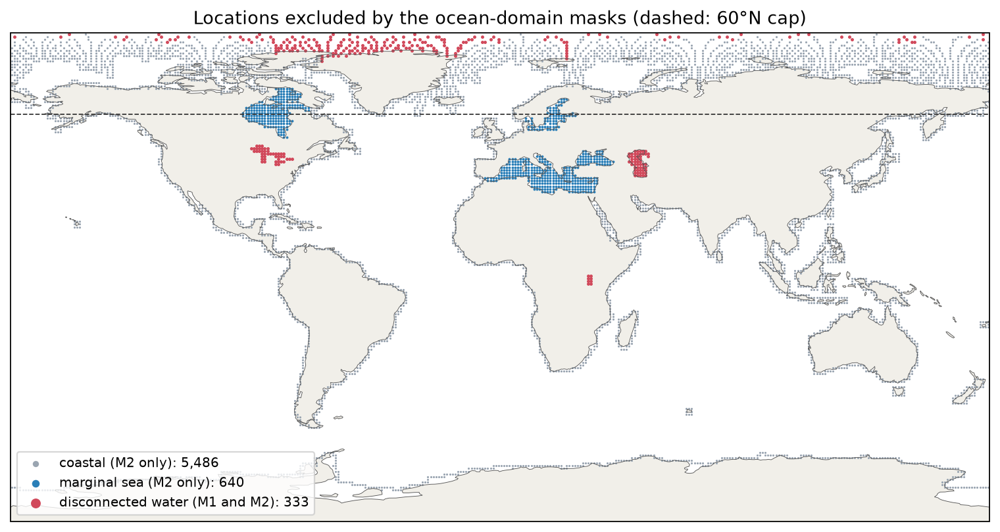

# Ocean-domain mask audit: results

Run 2026-10-21 under [the protocol](osse_ocean_mask_protocol.md), with
`scripts/build_ocean_mask.py` and `scripts/run_ocean_mask_audit.py`.
M0 is the saved latitude-cap audit; M1 and M2 are new fits (2 masks × 3 years
× 6 units × 3 strategies × 20 seeds). The new script reproduced the saved M0
2005 hidden-cell metrics to within 7e-15 µatm before the masked runs.

| Mask | Definition | Locations <60°N |
|---|---|---:|
| M0 | Original model domain | 36,215 |
| M1 (primary) | Connected to the world ocean; removes Caspian Sea, Great Lakes, Lake Victoria | 36,108 |
| M2 (sensitivity) | M1 without Mediterranean/Black Sea, Baltic, Hudson Bay and land-adjacent cells | 33,089 |

All values: 5,000 samples, spherical cell-area weighting, candidates and
evaluation below 60°N, µatm. Units are year means (hidden cells, n = 3) or
year–fold means (whole blocks, n = 15), each averaging 20 paired seeds.

## Historical-density minus random

| Protocol | Mask | Random MAE | Historical MAE | ΔMAE | Relative | Units worse (MAE) | ΔRMSE |
|---|---|---:|---:|---:|---:|---:|---:|
| Hidden cells | M0 | 9.508 | 11.975 | +2.466 | +25.94% | 3/3 | +4.224 |
| Hidden cells | **M1** | **9.226** | **11.746** | **+2.520** | **+27.32%** | **3/3** | **+4.228** |
| Hidden cells | M2 | 7.843 | 10.033 | +2.189 | +27.91% | 3/3 | +3.059 |
| Whole blocks | M0 | 11.836 | 13.691 | +1.855 | +15.67% | 15/15 | +1.310 |
| Whole blocks | **M1** | **11.363** | **13.404** | **+2.041** | **+17.96%** | **15/15** | **+2.029** |
| Whole blocks | M2 | 9.677 | 11.613 | +1.936 | +20.00% | 15/15 | +2.345 |

Per-year hidden-cell ΔMAE (M0 / M1 / M2): 2005 +2.194 / +2.321 / +2.023;
2010 +2.443 / +2.472 / +2.182; 2014 +2.763 / +2.768 / +2.362.

Signed bias difference stays negative in all three hidden-cell years under
every mask (−0.835 / −1.052 / −0.448), consistent with the earlier finding
that its size depends on the estimand.

## Coverage minus random

| Protocol | Mask | ΔMAE | Relative | Units worse (MAE) | ΔRMSE | Units lower RMSE |
|---|---|---:|---:|---:|---:|---:|
| Hidden cells | M0 | +0.186 | +1.96% | 3/3 | −1.745 | 3/3 |
| Hidden cells | **M1** | **+0.394** | **+4.27%** | **3/3** | **−1.008** | **3/3** |
| Hidden cells | M2 | +0.042 | +0.54% | 3/3 | −0.250 | 3/3 |
| Whole blocks | M0 | −0.007 | −0.06% | 7/15 | −2.201 | 14/15 |
| Whole blocks | M1 | +0.017 | +0.15% | 7/15 | −1.869 | 12/15 |
| Whole blocks | M2 | +0.050 | +0.52% | 10/15 | −0.178 | 14/15 |

## Interpretation under the prespecified rules

1. **Headline:** the M1 values replace M0: historical-density MAE is 27.32%
   higher than random (3/3 years) and 17.96% higher in the whole-block stress
   test (15/15).
2. **Robustness:** under M2 the historical-density minus random MAE has the
   same sign as under M1 in all three hidden-cell years, so the direction is
   robust to excluding marginal seas and coastal cells. The relative penalty
   is essentially unchanged (+27.9%) although absolute errors fall.
3. **Coverage:** signs agree between M1 and M2 for MAE (slightly worse) and
   RMSE (lower). The RMSE advantage, however, falls from −1.745 (M0) to −0.250
   µatm (M2): most of coverage's tail-error benefit comes from marginal seas and
   coastal cells, where random's RMSE is concentrated (20.1 → 11.4 µatm).
4. Removing the three lakes slightly *strengthened* the historical-density
   penalty, so the old domain was not inflating the headline.

## Not rerun

The 12-variant evaluation chart, the full-domain sample-count sweep, the 2005
supporting error map and the experiment globe remain pre-mask analyses and are
labelled as such on the website. North of 60°N is outside every mask.

Source tables: `results/public/osse_ocean_mask_{metrics,unit_summary,paired,overall}.csv`
and `results/public/osse_ocean_mask_cells.csv`.
